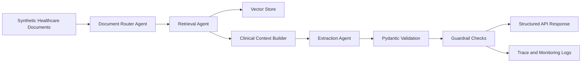

# Multi-Agent Healthcare Workflow Automation

Production-style multi-agent GenAI workflow for healthcare document routing, retrieval, structured extraction, validation, and responsible AI guardrails.

This repository is designed as a public portfolio project. It uses synthetic data and simplified workflows only. No employer code, patient data, internal prompts, or private architecture are included.

## What This Demonstrates

- Multi-agent orchestration for enterprise workflows
- Retrieval-Augmented Generation for contextual healthcare analytics
- Structured output validation with Pydantic-style schemas
- Responsible AI guardrails for hallucination monitoring and output filtering
- FastAPI service boundaries for production integration
- Audit-friendly logs for traceability and governance

## Architecture



## Features

- Agent routing by document type and requested task
- Semantic retrieval over synthetic healthcare notes
- Structured extraction into validated JSON
- Guardrail checks for unsupported claims and missing citations
- API-ready service layout
- Example traces showing decision flow and validation outcomes

## Tech Stack

- Python
- LangChain or AutoGen
- FastAPI
- Pydantic
- FAISS or Chroma
- AWS Bedrock-style guardrails
- Docker

## Suggested Repository Topics

`python`, `langchain`, `autogen`, `multi-agent`, `healthcare-ai`, `aws-bedrock`, `fastapi`, `pydantic`, `llmops`

## Quickstart

```bash
python -m venv .venv
.venv\Scripts\activate
pip install -r requirements.txt
python app.py
```

## Example Output

```json
{
  "document_type": "synthetic_clinical_summary",
  "routing_decision": "retrieve_then_extract",
  "answer": {
    "summary": "Synthetic patient record indicates follow-up is required.",
    "citations": ["doc_001#section_2"]
  },
  "validation": {
    "schema_valid": true,
    "unsupported_claims": 0,
    "guardrail_status": "passed"
  }
}
```

## Evaluation

- Structured output validation pass rate
- Citation coverage
- Unsupported-claim rate
- Average response latency
- Agent routing accuracy on synthetic cases

## Responsible AI And Security

- Uses synthetic sample data only
- No PHI, PII, employer data, or internal prompts
- Requires environment variables for secrets
- Adds guardrail checks before returning final outputs
- Logs traces without sensitive document contents

## Recruiter Signal

This project supports my Gen AI Engineer experience with multi-agent systems, RAG, enterprise healthcare workflows, responsible AI guardrails, and production-style Python APIs.

