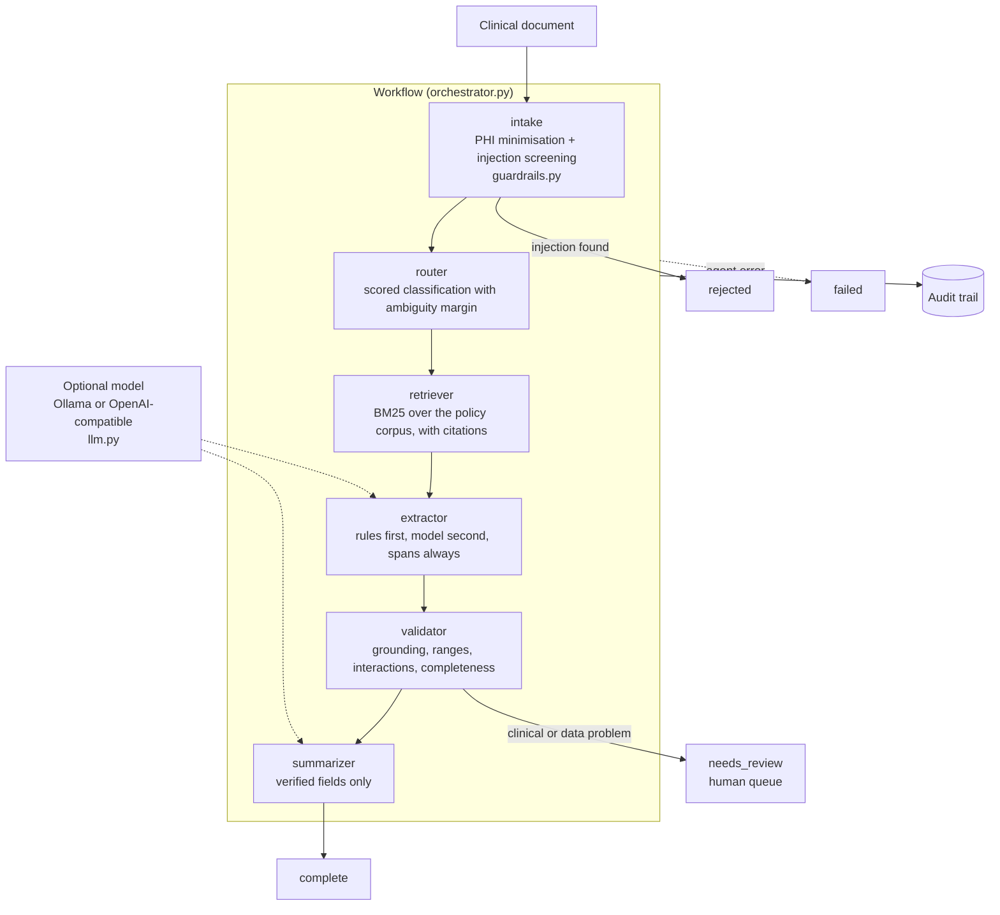
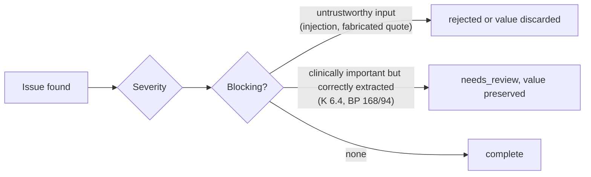

# Architecture and use cases

## System overview

A document enters a fixed pipeline of agents. The first step removes PHI and
screens for injected instructions, and it can stop the run. Later agents
classify, retrieve policy context, extract fields with provenance, validate and
summarise. The workflow ends in one of four decisions.

Agent order is data (`ROUTES`), not control flow. Lab reports skip retrieval and
summarisation, and referrals take the full path. A new document type is a
dictionary entry.

## Decisions

Severity and blocking are separate questions. A critical potassium is urgent
but correctly extracted, so it goes to a clinician. An injected instruction is
critical and untrustworthy, so nothing is preserved.

## Components

| Module | Responsibility |
|---|---|
| `orchestrator.py` | `Workflow`: `run`, `run_batch`, retries, escalation, `audit` |
| `guardrails.py` | PHI redaction and pseudonymisation, injection screening, grounding checks |
| `agents/router.py` | Document-type classification with an ambiguity margin |
| `agents/retriever.py` | BM25 knowledge base with citations |
| `agents/extractor.py` | Rule-first field extraction with model assist and source spans |
| `agents/validator.py` | Grounding, physiological ranges, drug interactions, completeness |
| `agents/summarizer.py` | Template-first summary with output screening |
| `llm.py` | Provider adapters: null, echo, Ollama, OpenAI-compatible |
| `server.py` | FastAPI: `/v1/process`, `/v1/batch`, `/v1/screen`, `/v1/kb`, `/v1/audit`, `/policy`, `/health` |
| `cli.py` | `run`, `batch`, `demo`, `review`, `redact`, `kb` |

## Use cases

| Use case | Who | How it helps |
|---|---|---|
| Triage incoming discharge summaries, lab reports and referrals | Clinical operations | Documents are classified and routed, and clean ones pass straight through |
| Extract structured fields from free text | Data or analytics team | Every field carries the character span of the text that produced it |
| Build a clinician review queue | Clinical lead | Abnormal vitals, drug interactions and impossible values are escalated and ranked by severity |
| Keep PHI away from a model | Privacy officer | Identifiers are removed or pseudonymised first, and `redact` shows exactly what would leave the boundary |
| Defend against poisoned documents | Security engineer | Embedded instructions are quarantined before any agent runs |
| Prevent fabricated findings reaching a clinician | Safety reviewer | A value whose quoted evidence is not in the document is discarded |
| Process a batch with an audit trail | Compliance | Batch runs report straight-through rate, review rate and a per-document audit |
| Run fully offline | Regulated environment | Rule-based extraction needs no model call. Ollama is optional |
| Change governance without code | Policy owner | Policy strictness is configuration, and default and strict give different decisions |

> This is a research and engineering reference using synthetic data. It is not a
> medical device and has not been clinically validated.
